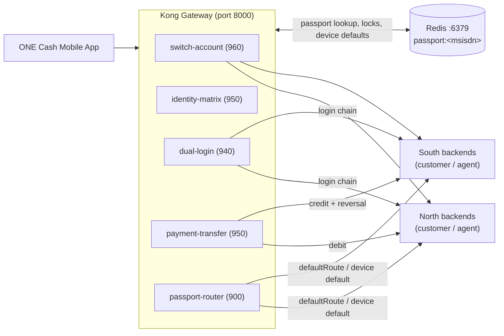

# kong4 — ONE Cash Dual-Region Kong Gateway

A **DB-less Kong Gateway (3.8)** that gives the ONE Cash platform a single edge entry point for customers with wallets in two independent regions — **North** and **South** — while keeping the underlying core systems (historically *Telepin* and *YottaGet*) completely invisible to the customer.

All region awareness lives in five custom Lua plugins plus a Redis-backed **Passport** store (`passport:<msisdn>`). The gateway itself is stateless: declarative config, rendered per environment at container start.



---

## Repo layout

```
.
├── docker-compose.yml                     # render one-shot + kong-gateway service
├── kong.Dockerfile                        # kong:3.8 + gettext-base (envsubst)
├── render.Dockerfile                      # alpine + jq + gettext (config renderer)
├── kong.yml.tpl                           # declarative config TEMPLATE — source of truth
├── kong.yml                               # rendered output (gitignored — never edit)
├── vars.dev.json                          # dev environment values
├── vars.priv.json                         # priv environment values
├── vars.prod.json                         # prod environment values (placeholders — fill before deploy)
├── .env / .env.dev / .env.priv            # compose env selection (real .env is gitignored)
├── plugins/
│   ├── passport-router/                   # dynamic region routing + response transform
│   ├── identity-matrix/                   # identity pre-check, login/registration guards
│   ├── switch-account/                    # switch / create-account journey engine
│   ├── payment-transfer/                  # cross-region debit→credit with rollback
│   └── dual-login/                        # sequential North→South login chain
├── kong4-gateway.postman_collection.json  # ready-to-run Postman collection
├── API_SUCCESS_RUNBOOK.md                 # ordered steps to succeed on every API
├── SWITCH_ACCOUNT_DOCUMENTATION.md        # full technical spec (from the 41-page story)
└── "Switch Account & Create New Account (South & North).pdf"   # source business story
```

## Configuration as code

Two files control everything:

| File | Controls | Edit when you change… |
|---|---|---|
| `kong.yml.tpl` | **Structure** — services, routes, plugins, upstreams | routing, plugin wiring |
| `vars.<env>.json` | **Values** — backend hostnames, Redis host, transform toggles | environment topology |

The render one-shot expands the template with `jq` + `envsubst`:

```
kong.yml.tpl  +  vars.<KONG_ENV>.json   →   kong.yml
```

It **fails loudly** if any `${TOKEN}` is left unexpanded, and warns if the vars file declares `_status: PLACEHOLDER…` (currently the case for `vars.prod.json` — fill in real hostnames before deploying prod).

## Quick start

Prerequisites: **Docker Desktop** and a **Redis reachable on port 6379** (the container reaches the host via `host.docker.internal`).

```bash
# start with the default environment (priv)
docker compose up -d

# or pick an environment explicitly
KONG_ENV=dev docker compose up -d          # Linux / macOS
# PowerShell:  $env:KONG_ENV="dev"; docker compose up -d

# only (re-)render kong.yml, without touching the running gateway
docker compose run --rm render

# hot-reload a freshly rendered config into the running gateway (no restart)
curl -X POST http://localhost:8001/config -F "file=@kong.yml"
```

| Port | Purpose |
|---|---|
| `8000` | Proxy (all APIs) |
| `8443` | Proxy (TLS) |
| `8001` | Admin API (`GET /services`, `GET /routes`, …) |

**Alternative env path:** instead of the vars file, export `NORTH_CUSTOMER_TARGET`, `SOUTH_CUSTOMER_TARGET`, `NORTH_AGENT_TARGET`, `SOUTH_AGENT_TARGET`, `REDIS_HOST` before `docker compose up -d` — the Kong container then self-renders the template from those env vars at start.

## Environments

| Env | Select with | Backend targets | Notes |
|---|---|---|---|
| `dev` | `KONG_ENV=dev` | `host.docker.internal:8080/8081/8082/9080` | local mock backends |
| `priv` | `KONG_ENV=priv` (default) | private-network IPs (see `vars.priv.json`) | private test environment |
| `prod` | `KONG_ENV=prod` | `*.internal` placeholders | **fill real hostnames first** — render warns |

## Routes

Kong picks the **most specific route**, so each exact path is served by exactly one plugin:

| Request path | Service | Plugin (priority) | Behavior |
|---|---|---|---|
| `/NWC/**` (any other path) | `customer-svc` | `passport-router` (900) | Routes to North/South by `defaultRoute` or per-device default; injects trusted headers; annotates/transforms responses |
| `/AGENT/**` | `agent-svc` | `passport-router` (900) | Same, targeting the agent backends |
| `POST /payment/transfer` | `payment-svc` | `payment-transfer` (950) | Cross-region debit→credit orchestration |
| `POST /login2`, `/auth/login2` | `dual-login-svc` | `dual-login` (940) | North login → (if success) South login → merged response |
| `POST /NWC/rest/Login`, `/NWC/rest/NewSeg`, `GET /NWC/rest/identity/check` | `identity-svc` | `identity-matrix` (950) | Identity pre-check and login/registration guards |
| `/switch/*`, `/NWC/rest/switch/*`, `/NWC/rest/register/second-account` | `switch-svc` | `switch-account` (960) | Switch / create-account journey engine |

## Custom plugins

| Plugin | Priority | What it does |
|---|---|---|
| **switch-account** | 960 | Journey decision engine for `GET /switch/decision` (`SWITCH` / `CREATE` / `FIRST_TIME_PIN_SETUP` / `REPLACEMENT` / `BLOCKED`), status & restriction guards (suspended / AML-blocked), per-device default wallet (`X-Device-Id`), 2-wallets-per-MSISDN limit, registration idempotency lock, scrubs `Telepin`/`YottaGet` from responses, structured audit logs |
| **identity-matrix** | 950 | Login/registration decision matrix from the passport object (`isNorthExisted` / `isSouthExisted`, statuses, PIN state, device defaults). Standard error codes (`REG-ID-*`, `SW_*`, `PIN-*`), idempotency lock on registration |
| **payment-transfer** | 950 | Safe cross-region transfer: write-ahead state machine in Redis, destination status inquiry before rollback, automatic reversal on the source account, background retry worker + Redis dead-letter queue |
| **dual-login** | 940 | Stateless sequential login chain: North first, South only if North succeeds (South payload from `plugins/dual-login/south_payload.json`). No Redis |
| **passport-router** | 900 | The default router: picks North/South upstream per request from `passport:<msisdn>` (`defaultRoute` → per-device default → newest profile), injects `X-Region` / `X-Account-Id` / `X-Passport-Guid`, and applies optional per-region response transforms (add/delete fields & headers, region header) |

## Request headers

| Header | Required by | Values |
|---|---|---|
| `X-MSISDN` | all passport-guarded APIs (falls back to `msisdn`/`username` in query/body) | e.g. `967700000001` |
| `X-Device-Id` | per-device default resolution, device binding | e.g. `DEVICE-IPHONE-14` |
| `X-Target-Region` | registration, switch-authenticate, create | `NORTH` \| `SOUTH` |
| `X-Transaction-Id` | payment transfer only (optional idempotency key) | UUID |

## Testing

PowerShell suites seed Redis passports and exercise the plugins end-to-end:

```powershell
.\plugins\switch-account\test-switch-account.ps1
.\plugins\identity-matrix\test-identity-matrix.ps1
```

Or import **`kong4-gateway.postman_collection.json`** and run against `http://localhost:8000`.

## Documentation

- **[API_SUCCESS_RUNBOOK.md](API_SUCCESS_RUNBOOK.md)** — ordered steps to reach a successful (2xx) result on every API, with exact headers, payloads, and failure branches.
- **[SWITCH_ACCOUNT_DOCUMENTATION.md](SWITCH_ACCOUNT_DOCUMENTATION.md)** — full technical specification: architecture, Kong-vs-backend-vs-mobile responsibility split, Redis Passport v2 contract, acceptance criteria.
- **[plugins/identity-matrix/README.md](plugins/identity-matrix/README.md)** — plugin v2.0 details and config reference.
