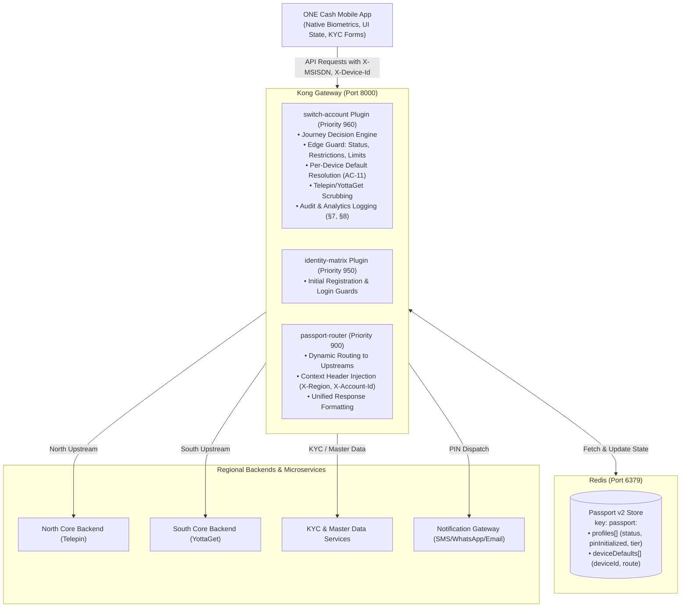

# Technical Specification & Documentation: Switch Account & Create New Account (South & North)

> **Document Version:** 1.0.0  
> **Source Story:** `Switch Account & Create New Account (South & North).pdf` (41 Pages)  
> **Target System:** Kong API Gateway (DB-less) + Redis Passport Layer + Spring Boot Event Consumer  
> **Target Audience:** Solution Architects, Gateway Engineers, Backend Developers, Mobile App Engineers  

---

## 1. Executive Summary & Architecture Overview

The **ONE Cash** platform allows customers to hold accounts across two distinct geographic regions: **South** and **North**. The systems powering these regions operate independently (historically backed by systems like *Telepin* and *YottaGet*). 

The goal of this epic is to give the customer a **single unified mobile application experience** where they can:
1. Seamlessly switch between their South and North wallets under the same mobile number (`MSISDN`).
2. Discover when they are eligible to create a second wallet in the opposite region, and complete the creation journey.
3. Keep wallet security, PIN states, KYC requirements, balances, and device default preferences completely isolated per region.
4. Ensure internal backend names (*Telepin*, *YottaGet*) are completely invisible to the customer.

### High-Level Architectural Flow



---

## 2. Responsibility Split: Kong Gateway vs Backend vs Mobile App

| Story Area / AC | Kong Gateway Edge Responsibility | Backend Services Responsibility | Mobile App Responsibility |
|---|---|---|---|
| **AC-01 to AC-04: Journey Decision at Tap** | **Decision Engine Endpoint (`GET /switch/decision`)**: Inspects Redis passport, evaluates statuses, PIN setup, and device default. Returns next action: `SWITCH`, `CREATE`, `FIRST_TIME_PIN_SETUP`, `REPLACEMENT`, or `BLOCKED`. | Emits lifecycle status events to Kafka to keep Redis up-to-date. | Renders Switch/Create UI or prompts according to the action returned. |
| **AC-05, AC-10, AC-22: Switch Execution & Refresh** | Routes target wallet authentication to target upstream (`north-backend` or `south-backend`). Rejects restricted target accounts (`SW_003`). Stamps trusted headers (`X-Region`, `X-Account-Id`, `X-Passport-Guid`). | Validates target PIN against regional core DB; counts failed PIN attempts against target wallet (`SW_001`). | Discards old wallet cache; refreshes balance, currency, transaction history, and alias. |
| **AC-06, AC-07, AC-08: PIN Setup & Default PIN** | Detects uninitialized PIN (`pinInitialized == false`) and returns `FIRST_TIME_PIN_SETUP` (`SW_005`). Routes PIN setup calls to target region backend. | Generates temporary 4-digit Default PIN; dispatches via SMS (North/South), WhatsApp (South/Intl), or Email (Intl) (AC-07); validates PIN rules (AC-08). | Displays masked numeric keypad for PIN entry (AC-08); handles PIN confirmation matching. |
| **AC-09: Device Binding** | Extracts and forwards `X-Device-Id`. Blocks access from unauthorized or blocked devices (`SW_007`). | Validates device authorization in DB; triggers OTP if device is not bound to target wallet. | Captures device hardware ID; displays OTP prompt when required. |
| **AC-11: Per-Device Default Wallet** | **Device Preference Storage**: Looks up `deviceDefaults` for `X-Device-Id` before falling back to global `defaultRoute`. Provides `POST /switch/set-default` to update device preference in Redis. | Persists device default in customer profile DB. | Prompts user ("Make this your default account on this device?") after successful switch. |
| **AC-12, AC-19: 2 Wallets per MSISDN Limit** | **Edge Enforcement**: Rejects creation attempt if customer already has 2 wallets (`409 Conflict`, `REG-ID-012`). Forces creation to opposite region only. | Enforces database uniqueness constraint. | Hides or disables "Create New Account" button when customer already holds 2 wallets. |
| **AC-19 (Scenario 9): 3 Accounts per ID Limit** | Forwards identity context headers. | **Central KYC / Core Banking**: Validates whether national ID number has reached the 3-account limit for the target region across different MSISDNs. | Displays `REG-ID-005` error message. |
| **AC-13 to AC-18: KYC & Location Hierarchy** | Routes KYC requests to target region upstream. Enforces target region match. | Manages Region→City→District master data (AC-17), T&C versioning (AC-18), OCR scanning, and age >= 18 checks (AC-16). | Handles document scanner and cascading location dropdowns. |
| **AC-02, §2.4, §2.5: Restricted Accounts Guard** | In `access()`: If default/only account is `AML_BLOCKED` or `SUSPENDED`, immediately blocks account creation and self-registration with a neutral customer support message. | Sets account status in backend and emits Kafka events. | Displays neutral message without revealing sensitive investigation info. |
| **AC-20: Idempotency Guard** | Redis `SET lock:create:<msisdn> 1 EX 10 NX` prevents duplicate account creation submissions (`429 Too Many Requests`, `PIN-017`). | Enforces DB transaction isolation. | Disables submit button and shows loading spinner during processing. |
| **§2.1: Internal Name Masking** | In `body_filter()`: Scrubs all occurrences of `Telepin` and `YottaGet` from responses and replaces with `Core Banking`. | Avoids sending internal system identifiers in user-facing JSON fields. | Never displays internal system names to users. |
| **§7, §8: Audit & Analytics** | Emits structured JSON events (`switch_completed`, `account_created`, etc.) in `log()` phase, with strict redaction of PINs and credentials. | Records backend transactional audit logs. | Logs client-side user journey analytics. |
| **AC-25: Regional Migration Restrictions** | Kong **never** modifies a wallet's region based on zero balance or address update. | Risk backoffice workflow handles manual review and approval. | N/A |

---

## 3. Data Model: Redis Passport v2 Contract

Stored at Redis key `passport:<msisdn>`:

```json
{
  "guid": "550e8400-e29b-41d4-a716-446655440000",
  "msisdn": "967700000001",
  "defaultRoute": "SOUTH",
  "lastUpdated": "2026-11-10 01:00:00",
  "deviceDefaults": [
    {
      "deviceId": "DEVICE-IPHONE-14",
      "route": "SOUTH",
      "lastUpdated": "2026-11-10 01:00:00"
    },
    {
      "deviceId": "DEVICE-SAMSUNG-S23",
      "route": "NORTH",
      "lastUpdated": "2026-11-10 01:05:00"
    }
  ],
  "profiles": [
    {
      "route": "SOUTH",
      "accountId": 2009876,
      "persona": ["customer"],
      "personaId": ["1"],
      "isDefault": true,
      "status": "ACTIVE",
      "pinInitialized": true,
      "tier": "TIER1",
      "kycStatus": "VERIFIED",
      "lastUpdated": "2026-11-10 01:00:00"
    },
    {
      "route": "NORTH",
      "accountId": 1002345,
      "persona": ["customer"],
      "personaId": ["1"],
      "isDefault": false,
      "status": "NOT_INITIALIZED",
      "pinInitialized": false,
      "tier": "TIER0",
      "kycStatus": "PENDING",
      "lastUpdated": "2026-11-10 01:05:00"
    }
  ]
}
```

### Profile Status Definitions:
- **`ACTIVE`**: Wallet is healthy, PIN initialized, eligible for login and switching.
- **`TIER0` / `DOWNGRADED`**: Active with limited transaction limits; eligible to create a second wallet in opposite region.
- **`NOT_INITIALIZED`**: Wallet record created in backend, but permanent PIN not yet chosen (`pinInitialized == false`).
- **`SUSPENDED`**: Temporarily restricted; switching to it is blocked; creating new accounts to bypass is blocked.
- **`AML_BLOCKED`**: Compliance/Risk restriction; completely blocked with neutral support message.
- **`TERMINATED`**: Inaccessible for switching; eligible for replacement account in that region subject to compliance.

---

## 4. Kong Plugin Architecture: `switch-account`

The `switch-account` plugin runs at **Priority 960** (prior to `identity-matrix` 950 and `passport-router` 900).

### API Endpoints Exposed by Kong:

### 1. `GET /switch/decision` (or `/NWC/rest/switch/decision`)
Evaluates customer's linked wallets, account statuses, and device preference.

**Headers:**
- `X-MSISDN`: Customer phone number (Required)
- `X-Device-Id`: Current device hardware/app UUID (Optional)

**Success Responses:**

*Case A: Two Active Wallets (Eligible for Switch)*
```json
{
  "status": true,
  "action": "SWITCH",
  "activeWallet": {
    "region": "SOUTH",
    "accountId": 2009876,
    "status": "ACTIVE",
    "pinInitialized": true,
    "tier": "TIER1"
  },
  "targetWallet": {
    "region": "NORTH",
    "accountId": 1002345,
    "status": "ACTIVE",
    "pinInitialized": true,
    "tier": "TIER1",
    "isAccessible": true
  },
  "canSwitch": true,
  "canCreate": false,
  "devicePreference": {
    "deviceId": "DEVICE-IPHONE-14",
    "preferredRoute": "SOUTH"
  }
}
```

*Case B: Only One Wallet (Eligible to Create Second Wallet Opposite)*
```json
{
  "status": true,
  "action": "CREATE",
  "canSwitch": false,
  "canCreate": true,
  "existingWallet": {
    "region": "SOUTH",
    "accountId": 2009876,
    "status": "ACTIVE",
    "pinInitialized": true,
    "tier": "TIER1"
  },
  "targetRegion": "NORTH",
  "devicePreference": {
    "deviceId": "DEVICE-IPHONE-14",
    "preferredRoute": "SOUTH"
  }
}
```

*Case C: Target Wallet PIN Not Initialized (Scenario 4 / AC-06)*
```json
{
  "status": true,
  "action": "FIRST_TIME_PIN_SETUP",
  "errorCode": "SW_005",
  "message": "PIN not initialized.",
  "activeWallet": { "region": "SOUTH", "accountId": 2009876, "status": "ACTIVE" },
  "targetWallet": { "region": "NORTH", "accountId": 1002345, "status": "NOT_INITIALIZED", "pinInitialized": false },
  "canSwitch": true,
  "canCreate": false
}
```

*Case D: One Wallet Terminated (Scenario 7)*
```json
{
  "status": true,
  "action": "SWITCH_AND_REPLACEMENT",
  "replacement": {
    "available": true,
    "region": "SOUTH"
  },
  "canSwitch": true,
  "canCreate": true
}
```

*Case E: AML-Blocked / Suspended (Scenario 6)*
```json
HTTP/1.1 403 Forbidden
{
  "status": false,
  "action": "BLOCKED",
  "errorCode": "SW_003",
  "message": "Your account is currently unavailable. Please contact customer support."
}
```

---

### 2. `POST /switch/authenticate` (or `/NWC/rest/switch/authenticate`)
Routes authentication to the target wallet's backend upstream.

**Headers:**
- `X-MSISDN`: Customer phone number
- `X-Device-Id`: Current device identifier
- `X-Target-Region`: `NORTH` or `SOUTH`

**Kong Execution:**
1. Verifies target wallet exists in Redis and status is `ACTIVE` (rejects `SW_003` if Blocked/Suspended/AML/Terminated).
2. Verifies `pinInitialized == true` (rejects `SW_005` if not initialized).
3. Calls `kong.service.set_upstream(conf.target_upstream)` to point to target backend.
4. Injects trusted headers: `X-Region`, `X-Account-Id`, `X-Persona`, `X-Persona-Id`, `X-Passport-Guid`, `X-Device-Id`.

---

### 3. `POST /switch/set-default` (or `/NWC/rest/switch/set-default`)
Persists per-device preferred wallet (AC-11).

**Request Body:**
```json
{
  "deviceId": "DEVICE-IPHONE-14",
  "targetRegion": "SOUTH"
}
```
**Response:**
```json
HTTP/1.1 200 OK
{
  "status": true,
  "message": "Default wallet updated for this device",
  "deviceId": "DEVICE-IPHONE-14",
  "route": "SOUTH"
}
```

---

### 4. `POST /switch/create` (or `/NWC/rest/register/second-account`)
Guarded entry for creating the second regional wallet.

**Kong Execution & Edge Checks:**
1. Checks that customer has exactly 1 existing wallet. If 2 exist, returns `409 Conflict` (`REG-ID-012`, *"You already have the maximum number of accounts allowed for this mobile number"*).
2. Enforces opposite region: if existing wallet is South and request is South, returns `400 Bad Request` (`REG-ID-012`, *"You already have an account in this region"*).
3. Verifies existing wallet is not Suspended or AML-blocked (returns `403 Forbidden`, `REG-ID-013`).
4. Idempotency lock: Redis `SET lock:create:<msisdn> 1 EX 10 NX`. If key already exists, returns `429 Too Many Requests` (`PIN-017`, *"Your request is already being processed. Please wait"*).
5. Routes request to opposite region backend with injected headers.

---

## 5. Error Code and Validation Catalogue (§4 & §5)

### Switch Account Codes (`SW_*`)
| Code | User Message | Trigger Condition |
|---|---|---|
| `SW_001` | "Incorrect PIN. Please try again." | Target backend authentication fails invalid PIN check. |
| `SW_002` | "Authentication failed. Please try again or use your PIN." | Biometric authentication fails or is rejected. |
| `SW_003` | "This account is not accessible." | Target wallet is `BLOCKED`, `SUSPENDED`, `AML_BLOCKED`, or `TERMINATED`. |
| `SW_004` | "Default PIN expired. Please request a new one." | Default PIN validity period has expired. |
| `SW_005` | "PIN not initialized." | Target wallet exists but permanent PIN has not been set. |
| `SW_006` | "Maximum attempts exceeded. Please try again later." | Exceeded maximum retry attempts for PIN. |
| `SW_007` | "This device cannot be used to access this account." | Device is not authorized for target wallet. |
| `SW_008` | "System unavailable." | Redis connection failure or upstream backend timeout. |

### Registration & Account Limits Codes (`REG-ID-*`)
| Code | User Message | Trigger Condition |
|---|---|---|
| `REG-ID-001` | "This field is required." | Missing required header (e.g. `X-MSISDN`). |
| `REG-ID-005` | "This ID is linked to more than three accounts." | Identity number exceeds 3 accounts in target region (Backend DB). |
| `REG-ID-006` | "You already have three accounts with the same ID." | Same as above. |
| `REG-ID-012` | "You already have the maximum number of accounts allowed for this mobile number." | Attempt to create a 3rd wallet under the same MSISDN. |
| `REG-ID-012` | "You already have an account in this region." | Attempt to create a 2nd wallet in the same region. |
| `REG-ID-013` | "We are unable to process your request at this time. Please contact customer support." | Suspended or AML-blocked customer attempts account creation. |
| `PIN-017` | "Your request is already being processed. Please wait." | Idempotency lock active; duplicate submit attempt. |

---

## 6. Audit & Analytics Logging (§7 & §8)

In the `log()` phase, `switch-account` emits structured events for monitoring and observability:

```json
{
  "event": "switch_completed",
  "msisdn": "967700000001",
  "deviceId": "DEVICE-IPHONE-14",
  "path": "/switch/authenticate",
  "targetRegion": "SOUTH",
  "targetAccountId": 2009876,
  "httpStatus": 200,
  "latencyMs": 42,
  "timestamp": "2026-11-10T01:00:00Z"
}
```

### Supported Analytics Events (§8):
- `switch_initiated`
- `switch_completed`
- `switch_failed`
- `first_time_switch_detected`
- `default_wallet_changed`
- `account_created`
- `account_creation_validation_failed`

> [!CAUTION]
> **Data Redaction Rule:** Sensitive authentication credentials, Default PINs, new PINs, and OTPs are **never** logged to disk or console.

---

## 7. Traceability Matrix: Acceptance Criteria (AC-01 to AC-25)

| AC Code | Requirement Description | Implementation in Workspace |
|---|---|---|
| **AC-01** | Switch Account Entry Point inside authenticated app; identifies linked wallets and regions. | Implemented in `switch-account:handler.lua` under `is_decision`. |
| **AC-02** | Determine whether to switch or create; no 3rd wallet; opposite region enforcement. | Implemented in `switch-account:handler.lua` decision matrix. |
| **AC-03** | Display correct account options (Switch vs Create vs First-Time PIN Setup). | Exposed via `GET /switch/decision` payload. |
| **AC-04** | Validate target account status before switching (reject Blocked, Suspended, AML, Terminated). | Implemented in `switch-account:handler.lua` under `is_switch` returning `SW_003`. |
| **AC-05** | Switch to existing wallet with initialized PIN; validate against target wallet. | Dynamic upstream switching to target region with trusted headers. |
| **AC-06** | Switch to wallet whose PIN is not initialized; direct to First-Time PIN Setup (`SW_005`). | Handled in decision engine and switch guard. |
| **AC-07** | Default PIN generation and delivery channels (SMS/WhatsApp/Email). | Backend responsibility; Kong routes endpoints and applies rate limits. |
| **AC-08** | Set new PIN; 4 digits, masked keypad, strength checks. | Backend & Mobile App responsibility. |
| **AC-09** | Device binding and authorization; separate binding per wallet. | Kong checks and forwards `X-Device-Id`; backend enforces OTP verification. |
| **AC-10** | Complete switch and refresh wallet information; safe state on load failure. | Mobile app cache invalidation; Kong response sanitization. |
| **AC-11** | Default wallet preference for each device (device-specific defaults). | Implemented via `deviceDefaults[]` in Passport v2, `passport-router`, and `POST /switch/set-default`. |
| **AC-12** | Create New Account entry point; KYC eligibility and limit checks. | Implemented in `switch-account:handler.lua` under `is_create`. |
| **AC-13** | KYC info prefill, read-only mobile number, target region KYC fields. | Backend KYC service & Mobile App form. |
| **AC-14** | Identity types per region (ID North 11 digits, ID South 12 digits, Passport 3-9 chars). | Backend KYC validation rules. |
| **AC-15** | Special KYC behavior when creating South account (prefill name/gender, Tier 1 lock). | Backend KYC service. |
| **AC-16** | Regional KYC validation rules (age >= 18, expiry > issuance). | Backend KYC service. |
| **AC-17** | Region, City, District dynamic population from backend master data. | Backend Master Data service. |
| **AC-18** | Region-specific Terms & Conditions versioning and acceptance. | Backend CMS & T&C acceptance store. |
| **AC-19** | Account limits: max 2 wallets per MSISDN; max 3 accounts per ID per region. | MSISDN limit enforced at Kong edge; 3-per-ID enforced in Backend core DB. |
| **AC-20** | Submit and create new wallet; idempotency lock to prevent duplicate creation. | Implemented via Redis `lock:create:<msisdn>` (10s TTL) returning `PIN-017`. |
| **AC-21** | Successful account creation: "Verify Now or Later". | Mobile App navigation flow & Backend KYC queue. |
| **AC-22** | Refresh wallet information after switching (balance, currency, alias). | Mobile App UI layer. |
| **AC-23** | Biometric authentication; PIN fallback; no bypass of account status checks. | Mobile App local auth; Kong enforces account status checks on every switch. |
| **AC-24** | Cancel and back navigation without corrupting session or creating ghost accounts. | Mobile App state machine. |
| **AC-25** | Regional migration restrictions (zero balance required; manual Risk approval only). | Risk Operations backoffice portal; Kong never auto-migrates regions. |

---

## 8. Deployment & Operational Runbook

### File Locations in Repository:
- **`src/main/java/com/onecash/dto/DeviceDefault.java`**: DTO for per-device default preferences.
- **`src/main/java/com/onecash/dto/Profile.java`**: Enriched profile with `status`, `pinInitialized`, `tier`, `kycStatus`.
- **`src/main/java/com/onecash/dto/Passport.java`**: Passport object containing `deviceDefaults[]`.
- **`src/main/java/com/onecash/service/PassportService.java`**: Service methods for passport and device default updates.
- **`src/main/java/com/onecash/controller/PassportRouterController.java`**: Controller exposing `/internal/routing/deviceDefault`.
- **`kong/plugins/switch-account/schema.lua`**: Plugin configuration schema.
- **`kong/plugins/switch-account/handler.lua`**: Plugin Lua implementation (Priority 960).
- **`kong/plugins/passport-router/handler.lua`**: Updated to resolve per-device default routes (Priority 900).
- **`kong/kong.yml.tpl` & `kong/kong.yml`**: Declarative config defining `switch-svc` and `/switch/*` routes.
- **`kong/docker-compose.yml`**: Volume mounts and plugin list.
- **`kong/plugins/switch-account/test-switch-account.ps1`**: Automated verification test suite.

### Running Automated Verification Tests:
Once the Kong container and Redis instance are running:
```powershell
cd C:\projects\kafka-consumer\kong\plugins\switch-account
.\test-switch-account.ps1 -KongUrl "http://localhost:8000" -RedisHost "localhost" -RedisPort 6379
```
The test suite seeds Redis with customer passport profiles and tests all 16 scenarios, verifying that status codes, decision actions, and error codes match the business specifications.
